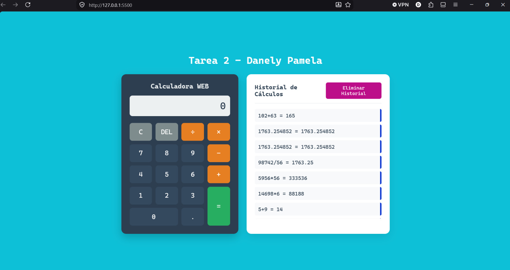

# Tarea 2: Calculadora WEB

**Estudiante:** Danely Pamela Luis Perez  
**Matrícula:** 2025-1214  
**Asignatura:** Programación Web  

---

## Descripción del Proyecto
Calculadora web interactiva desarrollada con HTML5, CSS3 moderno con temática Cyberpunk/Dark UI, y lógica programada en JavaScript (estándar ES5). 

### Características principales:
* **Operaciones básicas:** Suma, resta, multiplicación y división.
* **Persistencia de datos:** Integración de la API de `localStorage` para registrar el historial de operaciones realizadas.
* **Gestión de memoria:** Opción de depuración del historial mediante el botón de purgado.
* **Diseño responsivo:** Adaptable a pantallas móviles y de escritorio.

---

## Captura de Pantalla

